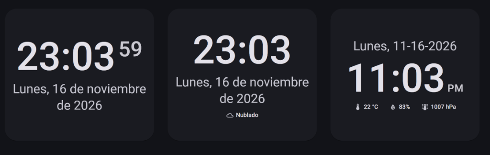
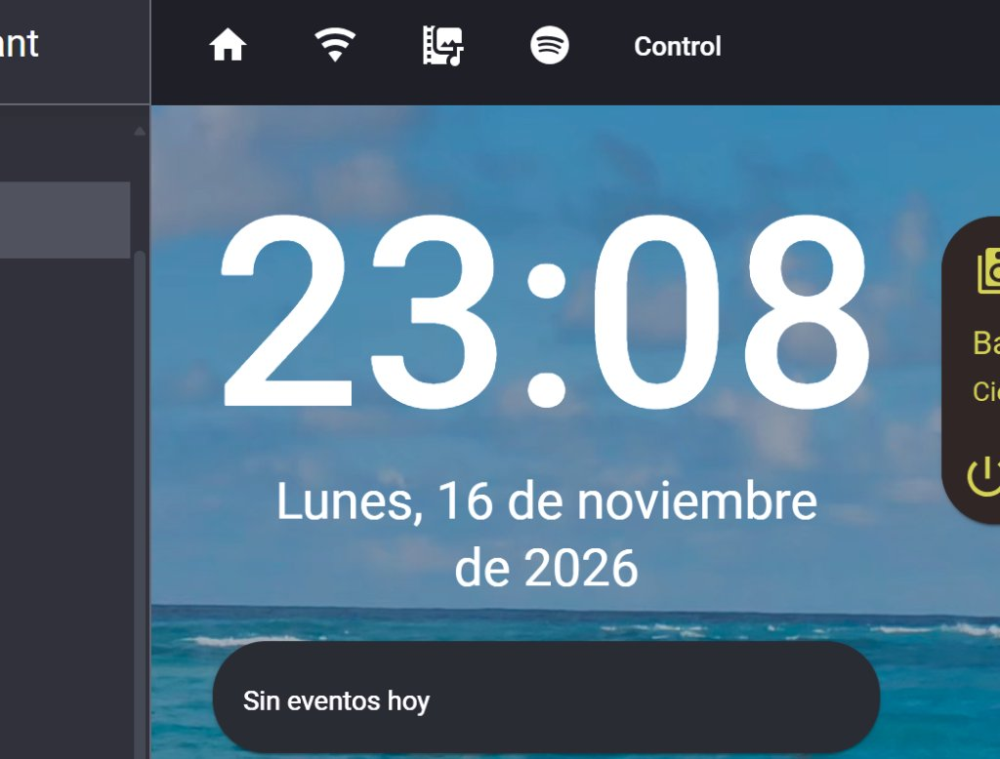

# Simple Clock Card

A customizable **Home Assistant Lovelace clock card** with a real-time digital clock, date and status entities. It is fully configurable from the Home Assistant Visual Editor, with no YAML required.



### Transparent & Floating Dashboard Mode
Seamlessly blend the clock directly into your dashboard background or wallpaper with 0% opacity, optional glassmorphism blur, and hidden borders:



## Features

- **100% Visual Configuration**: Built with native Home Assistant `ha-selector` controls organized into expandable sections (`Clock`, `Date & Language`, `Status Entities (3)`, `Size & Typography`, `Colors & Transparency`).
- **Flexible Time Display**:
  - Hours only (`HH`), Hours & Minutes (`HH:MM`), or Hours, Minutes & Seconds (`HH:MM:SS`).
  - Seconds style: same size inline, small superscript, or small subscript.
  - 24-hour or 12-hour (`AM/PM` inline, superscript, subscript, or below).
  - Leading zero toggle, blinking `:` separator toggle, and optional custom IANA timezone.
- **Multi-Language Support (9 Languages + Auto)**:
  - Automatic detection from Home Assistant language (`auto`), or force any language:
    - `en` — English
    - `es` — Español
    - `it` — Italiano
    - `pt` — Português
    - `pt-BR` — Português do Brasil
    - `ru` — Русский
    - `de` — Deutsch
    - `fr` — Français
    - `zh-Hans` — 简体中文
  - Translates both long dates (weekday & month names with authentic grammar) and the Visual Editor interface.
- **Short & Long Date Formats**:
  - Short date order: `DD/MM/YYYY`, `MM/DD/YYYY`, or `YYYY/MM/DD` with configurable separator (`/`, `-`, `.`) and 2/4-digit year.
  - Long date options: full/short/hidden weekday, full/abbreviated month, show/hide year, capitalization toggle.
  - Combined mode: Weekday + Short date.
  - Place date above or below the clock.
- **3 Status Entity Slots**:
  - Up to 3 optional status chips placed above or below the clock.
  - Pick any entity **and optionally select any entity attribute** (for example `temperature` or `humidity` from a `weather.*` entity).
  - Customize icon, name, unit, and visibility toggles per slot.
  - Clicking an entity opens Home Assistant's `more-info` dialog.
- **Size, Typography, Colors & Transparency**:
  - Independent sliders for card padding, minimum height, clock size, seconds/AM-PM size, date size, entity size, spacing, corner radius, alignment, font weight, and font style.
  - Supports Home Assistant **Sections** grid resizing (`getGridOptions`).
  - Custom text colors, icon color, background color, background opacity (`0%`–`100%`), glassmorphism backdrop blur, and toggles to hide card border and shadow.

---

## Installation

### Marketplace / HACS (Recommended)

1. In Home Assistant, open **Marketplace** (via **Settings → Marketplace**) or **HACS**.
2. Search for **Simple Clock Card**.
3. Click **Download**.
4. Reload your browser or dashboard resources when prompted.

### Manual Installation

1. Download `simple-clock-card.js` (from the repository root or `dist/simple-clock-card.js`).
2. Copy it into `<config>/www/simple-clock-card.js`.
3. In Home Assistant, go to **Settings → Dashboards → Resources → Add Resource**:
   - URL: `/local/simple-clock-card.js`
   - Resource type: **JavaScript Module**
4. Reload your browser and add **Simple Clock Card** from the visual card picker.

---

## Development

```bash
npm install
npm run typecheck
npm run build
npm test
```

- `npm run build` outputs the compiled bundle to `dist/simple-clock-card.js` and copies it to `simple-clock-card.js`.
- `npm test` runs `tests/verify.mjs` to verify multi-language localization, date/time formatting, transparency utilities, entity attribute extraction, and the generated bundles.
